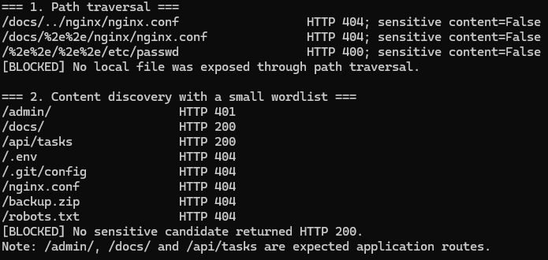
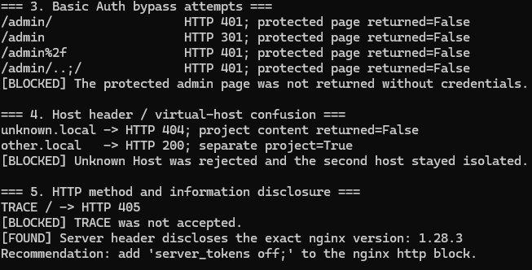

# Лабораторная работа 1 — настройка nginx

## Цель работы

Настроить nginx как единую точку входа и балансировщик для сервиса из лабораторной работы 0. Сайт должен работать по HTTPS и сохранять доступность API после остановки одного из двух экземпляров бэкенда.

## Состав стенда

| Компонент | Назначение | Доступ |
| --- | --- | --- |
| nginx | HTTPS, статика, проксирование, балансировка и ограничения | `127.0.0.1:80`, `127.0.0.1:443` |
| backend-1 | Первый экземпляр Flask API | только сеть Docker |
| backend-2 | Второй экземпляр Flask API | только сеть Docker |
| PostgreSQL | База данных приложения из лабораторной работы 0 | только внутренняя сеть Docker |

Стенд запускается одной командой:

```bash
docker compose up -d --build --wait
```

## HTTPS и перенаправление

В nginx настроены порты 80 и 443. HTTP-сервер возвращает `301`, сохраняя имя хоста и путь запроса. HTTPS использует самоподписанный сертификат, предназначенный только для локальной лабораторной среды.

```nginx
server {
    listen 80;
    server_name localhost 127.0.0.1 lab1.local other.local;
    return 301 https://$host$request_uri;
}
```


## Фронтенд и API

Статические файлы nginx читает из `/usr/share/nginx/html`. Запросы с префиксом `/api` передаются в `backend_pool`. Каждый ответ API содержит заголовок `X-Backend-Instance`, поэтому в проверке видно чередование `backend-1` и `backend-2`.

```nginx
upstream backend_pool {
    server backend-1:5000 max_fails=1 fail_timeout=5s;
    server backend-2:5000 max_fails=1 fail_timeout=5s;
}
```

При ошибке соединения nginx пробует следующий сервер. Таймаут соединения ограничен одной секундой, поэтому остановленный экземпляр не задерживает ответ надолго.

## Alias и виртуальные хосты

Путь `/docs/` подключён директивой `alias` и ведёт в каталог, который не является частью корня фронтенда. Для `other.local` создан отдельный `server` со своей статикой. Запрос к `/api` на втором домене возвращает 404, а неизвестный `Host` не получает содержимое ни одного проекта.

## Ограничение запросов

Для `/api` создана зона `limit_req` со скоростью 10 запросов в секунду и небольшим burst. При превышении nginx возвращает статус 429. Проверочный скрипт создаёт плотный поток запросов и считает ответы 200 и 429.

## Страница 404 и закрытый раздел

Несуществующие страницы основного проекта обрабатываются собственной страницей `frontend/404.html`. Каталог `/admin/` защищён через `auth_basic` и файл `nginx/htpasswd`. Без учётных данных сервер возвращает 401, с данными `admin / lab1admin` — 200.

## Проверка отказоустойчивости

Скрипт `scripts/check.sh` останавливает контейнер `backend-2`, выполняет несколько запросов к `/api/tasks` и проверяет одновременно два условия:

1. каждый запрос получает HTTP 200;
2. все ответы подписаны как `backend-1`.

После проверки `backend-2` запускается обратно и снова появляется в балансировке.


## Результаты

Команда `scripts/collect-evidence.ps1` сохраняет полный вывод в каталоге `evidence/`. Основной файл — `evidence/check-run.txt`; успешный прогон заканчивается строкой `FAIL=0`. Дополнительно сохраняются состояние контейнеров, версии Docker, журналы и результат `nginx -T`.


## Задание со звёздочкой — проверка безопасности

Проверялся только собственный локальный стенд `https://localhost`. Сторонние сайты не затрагивались, DDoS-нагрузка и подбор паролей не выполнялись. Скрипт `scripts/security-check.ps1` проводит пять групп проверок и сохраняет полный вывод в `evidence/security-check-run.txt`.

| Проверка | Что проверялось | Фактический результат |
| --- | --- | --- |
| Path traversal | Попытка выйти из каталога `/docs/` и прочитать конфигурацию или `/etc/passwd` | Сервер вернул 404/400, содержимое файлов не раскрыто |
| Поиск страниц и файлов | Небольшой словарь путей, включая `.env`, `.git/config` и резервную копию | Служебные и резервные файлы вернули 404; штатные `/docs/` и `/api/tasks` доступны |
| Обход Basic Auth | Варианты написания пути `/admin/` без логина и пароля | Получены 401/301, защищённая страница не возвращена |
| Подмена Host | Неизвестный домен и отдельный хост `other.local` | `unknown.local` вернул 404, а `other.local` — отдельный проект |
| Методы и заголовки | Метод TRACE и заголовок `Server` | TRACE отклонён с 405; обнаружено раскрытие версии nginx 1.28.3 |





Проверено пять категорий, подтверждён один недостаток низкой критичности: заголовок `Server` раскрывает точную версию nginx 1.28.3. Рекомендация — добавить `server_tokens off;` в блок `http` конфигурации nginx. Остальные попытки эксплуатации завершились неуспешно, что показывает корректную работу соответствующих механизмов защиты.

## Вывод

nginx настроен как HTTPS-точка входа для сервиса из лабораторной работы 0. Он разделяет статику и API, балансирует запросы между двумя бэкендами, ограничивает частоту запросов, обслуживает два виртуальных хоста, защищает административный раздел и сохраняет доступность API при отказе одного экземпляра. Дополнительная безопасная проверка документирует попытки эксплуатации и меры по усилению конфигурации.

