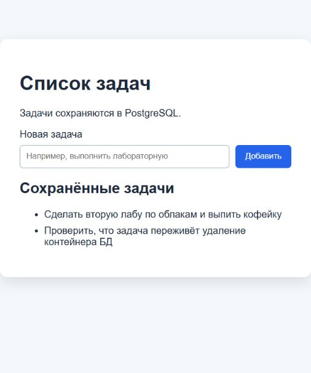

# Лабораторная работа 2 - Docker и звёздочка

Работа лежит в `lab-2`, ветка - `feature/lab-2` в [нашем репозитории](https://github.com/Sofa-maruysh/cloud-labs).

## Разделила приложение на три контейнера

Взяла список задач из [лабы 0](../lab-0/report.md). Там Flask отдавал и страницу, и API. Теперь страницу вынесла в nginx, а Flask оставила для работы с данными. Получилось три сервиса: фронтенд, бэкенд и PostgreSQL.


Папку `lab-0` не меняла. В [бэкенде](backend/app.py) сохранила таблицу `tasks`, добавила POST с JSON, проверку длины задачи и `/api/healthz`. Если БД недоступна, API возвращает `503`. Запускается бэкенд через gunicorn.

Добавила задачу через форму, обновила страницу - задача осталась.



## Сделала плохой и хороший Dockerfile

Сначала собрала рабочий [Dockerfile.bad](backend/Dockerfile.bad), в котором специально оставила плохие практики. Потом исправила их в [хорошем Dockerfile](backend/Dockerfile).

| Что было в плохом образе | Что поменяла и зачем |
| --- | --- |
| `FROM python:3.12`, без digest | Взяла `python:3.12.12-slim-bookworm` с SHA256: база меньше, версия закреплена |
| `COPY . .` перед `pip install` | Перенесла установку пакетов перед копированием кода, чтобы его правки не сбрасывали кеш зависимостей |
| Пустой `Dockerfile.bad.dockerignore` | Добавила [`.dockerignore`](backend/.dockerignore), чтобы лишний `notes-demo.txt` и другие ненужные файлы не попадали в образ |
| Одна стадия | Разделила сборку на `builder` и `runtime`, в финальном образе оставила готовое окружение и `app.py` |
| Сохраняется кеш pip | Добавила `--no-cache-dir`: кеш не нужен запущенному сервису |
| Нет `USER`, процесс работает от root | Создала пользователя `app` с UID 10001 |
| Нет `HEALTHCHECK` | Добавила проверку `/healthz`, которая делает `SELECT 1` в БД |

Версии пакетов закрепила в [requirements.txt](backend/requirements.txt). За основу взяла [рекомендации Docker по сборке](https://docs.docker.com/build/building/best-practices/).

В `builder` создаётся виртуальное окружение с зависимостями, затем оно копируется в `runtime`. Компиляторы здесь не понадобились: psycopg установился из готового wheel. Основную разницу в размере дала slim-база.

Плохой образ тоже проверила в сети лабораторной: API ответило `200`, `whoami` вернул `root`, настройка healthcheck была `null`. После проверки временный контейнер остановила.

```text
$ docker compose -f compose.yaml -f compose.bad.yaml run -d --rm --no-deps --name cloud-lab2-bad-demo backend
2a45348128f23cd37905d8dfbc35cb0ff501171c1abdcdfe86c006b57768001c
 Container cloud-lab2-bad-demo Creating
 Container cloud-lab2-bad-demo Created
exit_code=0
$ docker compose -f compose.yaml exec -T backend python -c "import urllib.request; r=urllib.request.urlopen('http://cloud-lab2-bad-demo:5000/api/healthz',timeout=10); print('bad API HTTP',r.status); print(r.read().decode())"
bad API HTTP 200
{"database":"ok","status":"ok"}
exit_code=0
$ docker exec cloud-lab2-bad-demo whoami
root
exit_code=0
$ docker inspect cloud-lab2-bad-demo --format "health={{json .Config.Healthcheck}} user={{json .Config.User}}"
health=null user=""
exit_code=0
$ docker stop cloud-lab2-bad-demo
cloud-lab2-bad-demo
exit_code=0
```

## Сравнила размер и время пересборки

Работала на Windows: Docker Desktop 4.62.0, Engine 29.2.1, Compose 5.0.2, контейнеры Linux/amd64. Docker видел 12 CPU и около 3.50 GiB памяти.

### Размер образов

| Метрика | Плохой | Хороший |
| --- | ---: | ---: |
| `.Size` из `docker image inspect` во время замера, байты | 427 711 435 | 56 242 097 |
| То же в MiB | 407.90 | 53.64 |
| `DISK USAGE` из `docker image ls` | 1.65 GB | 231 MB |

Сначала меня смутило, что `inspect` и `image ls` показывают разные числа. Оказалось, у containerd отдельно учитываются `CONTENT SIZE` и `DISK USAGE`, включая сжатые и распакованные слои. Хороший образ меньше по обеим метрикам. [Объяснение в документации Docker](https://docs.docker.com/engine/storage/containerd/).

### Пересборка после одной строки

Сначала собрала оба образа, чтобы прогреть кеш. Потом три раза меняла только строку `APP_LABEL` в `app.py` и пересобирала оба варианта. Зависимости оставались прежними, кеш Docker не отключала.

```bash
docker build --progress=plain -f backend/Dockerfile.bad -t cloud-lab2-backend:bad backend
docker build --progress=plain -f backend/Dockerfile -t cloud-lab2-backend:good backend
```

Время всей команды измеряла через `time.perf_counter()` в [скрипте](scripts/lab.py). После замеров вернула исходную строку.

| Замер | Плохой, с | Хороший, с |
| --- | ---: | ---: |
| 1 | 20.706 | 2.577 |
| 2 | 20.999 | 2.712 |
| 3 | 19.417 | 2.679 |
| Медиана | **20.706** | **2.679** |

В хорошем образе установка зависимостей осталась `CACHED`. В плохом пакеты каждый раз скачивались и устанавливались заново. На моём компьютере пересборка получилась примерно в 7.7 раза быстрее.

```text
Пересборка bad, замер 1: 20.706 s
Пересборка good, замер 1: 2.577 s
Пересборка bad, замер 2: 20.999 s
Пересборка good, замер 2: 2.712 s
Пересборка bad, замер 3: 19.417 s
Пересборка good, замер 3: 2.679 s
Размер bad: 427711435 bytes = 407.90 MiB
Размер good: 56242097 bytes = 53.64 MiB
```

До замеров скрипт один раз упал с `UnicodeEncodeError` при печати вывода pip. Переключила stdout на UTF-8, и логирование заработало.

Сохранила [вывод сборок](evidence/01-images-cache.txt), [результаты замеров](evidence/images.json) и [данные об образах](evidence/12-environment-images.txt).

## Подняла стек и проверила сети

Сервисы описала в [compose.yaml](compose.yaml) и запустила одной командой:

```bash
docker compose up --build -d --wait
docker compose ps
curl http://localhost:5052/api/healthz
```

Все три контейнера стали `healthy`, API ответило `200`. Наружу открыла только фронтенд на `127.0.0.1:5052`.

```text
$ docker compose -f compose.yaml ps
NAME                    IMAGE                                                                                              COMMAND                  SERVICE    CREATED          STATUS                    PORTS
cloud-lab2-backend-1    cloud-lab2-backend:good                                                                            "gunicorn --bind 0.0…"   backend    21 seconds ago   Up 15 seconds (healthy)   5000/tcp
cloud-lab2-db-1         postgres:17.6-alpine3.22@sha256:ef257d85f76e48da1c64832459b59fcaba1a4dac97bf5d7450c77753542eee94   "docker-entrypoint.s…"   db         9 minutes ago    Up 4 minutes (healthy)    5432/tcp
cloud-lab2-frontend-1   cloud-lab2-frontend:good                                                                           "nginx -g 'daemon of…"   frontend   18 seconds ago   Up 6 seconds (healthy)    127.0.0.1:5052->8080/tcp
exit_code=0
$ curl -sS --max-time 12 -w "\nHTTP %{http_code}\n" http://127.0.0.1:5052/api/healthz
{"database":"ok","status":"ok"}

HTTP 200
exit_code=0
```

В отчёт вставила фрагменты вывода команд. Полные логи сохранила в `evidence/`.

В хорошем бэкенде `docker compose exec -T backend whoami` вернул `app`, у фронтенда - `nginx`. Файл `notes-demo.txt` нашёлся только в плохом образе.

Фронт и бэк подключила к сети `web`, бэк и БД - к `data` с `internal: true`. Проверила подключения:

- Из бэкенда к `db:5432` - успешно.
- Из фронтенда к `db:5432` - `nc: bad address 'db'`, код выхода 1.
- Из фронтенда к IP базы `172.19.0.2:5432` - таймаут через две секунды, код выхода 1.

Проверила и IP, чтобы исключить проблему только с DNS. Адрес базы скрипт получил через `docker inspect`.

```text
$ docker compose -f compose.yaml exec -T backend whoami
app
exit_code=0
$ docker compose -f compose.yaml exec -T frontend whoami
nginx
exit_code=0
$ docker compose -f compose.yaml exec -T backend sh -c "test ! -e /app/notes-demo.txt && echo 'notes-demo.txt excluded'"
notes-demo.txt excluded
exit_code=0
$ docker run --rm --entrypoint sh cloud-lab2-backend:bad -c "whoami; ls /app/notes-demo.txt"
root
/app/notes-demo.txt
exit_code=0
db networks=['cloud-lab2_data']
frontend networks=['cloud-lab2_web']
$ docker compose -f compose.yaml exec -T backend python -c "import socket; s=socket.create_connection(('db',5432),2); print('backend -> db: connected'); s.close()"
backend -> db: connected
exit_code=0
$ docker compose -f compose.yaml exec -T frontend sh -c "nc -w 2 db 5432 < /dev/null"
nc: bad address 'db'
exit_code=1
$ docker compose -f compose.yaml exec -T frontend sh -c "nc -w 2 172.19.0.2 5432 < /dev/null"
exit_code=1
```

## Проверила, переживут ли данные удаление контейнера

Через API добавила задачу «Проверить, что задача переживёт удаление контейнера БД». Получила ID 1 и ответ `201`. Затем удалила только контейнер БД и создала его заново:

```bash
docker compose stop db
docker compose rm -f db
docker compose up -d db --wait
```

ID контейнера изменился, том остался `cloud-lab2_postgres_data`. GET вернул ту же задачу с ID 1. Данные сохранились в томе. Его я не удаляла, `down -v` не запускала.

Заодно проверила пустую задачу - API вернуло `400`.

```text
POST /api/tasks HTTP 201: {"created_at": "2026-10-09T21:40:15.860444", "id": 1, "text": "Проверить, что задача переживёт удаление контейнера БД"}
GET before=[{"created_at": "2026-10-09T21:40:15.860444", "id": 1, "text": "Проверить, что задача переживёт удаление контейнера БД"}]
db container before=ade4012fd9940549be7222dc24503a20e18020d023f1b21c027c948c400d474f
db container after =1b80257d861ad60eaf4983f42cffd3934a382af3f4a09f155eccfc72c42a1a78
volume before=cloud-lab2_postgres_data
volume after =cloud-lab2_postgres_data
GET after=[{"created_at": "2026-10-09T21:40:15.860444", "id": 1, "text": "Проверить, что задача переживёт удаление контейнера БД"}]
POST empty task: HTTP 400
```

Все эти проверки сохранила в [03-checks.txt](evidence/03-checks.txt).

## Звёздочка: восстановление после падения БД

У всех сервисов настроила healthcheck и `restart: unless-stopped`. Через `depends_on: condition: service_healthy` бэкенд ждёт готовую БД, а фронтенд - бэкенд. База проверяется через `pg_isready`, бэкенд - запросом к БД, фронтенд - по HTTP.

С проверкой падения с первого раза не вышло. Отправила `docker kill` и ждала перезапуска. БД осталась выключенной, `RestartCount` был 0, API вернуло `503`. Оказалось, Docker считает это ручной остановкой. [Лог первой попытки](evidence/04-recovery-first-attempt.txt), [документация restart policy](https://docs.docker.com/engine/containers/start-containers-automatically/).

```text
db RestartCount before=0
$ docker kill --signal=KILL 1b80257d861ad60eaf4983f42cffd3934a382af3f4a09f155eccfc72c42a1a78
1b80257d861ad60eaf4983f42cffd3934a382af3f4a09f155eccfc72c42a1a78
exit_code=0
$ curl -sS --max-time 12 -w "\nHTTP %{http_code}\n" http://127.0.0.1:5052/healthz
frontend ok

HTTP 200
exit_code=0
$ curl -sS --max-time 12 -w "\nHTTP %{http_code}\n" http://127.0.0.1:5052/api/healthz
{"error":"\u0411\u0430\u0437\u0430 \u0432\u0440\u0435\u043c\u0435\u043d\u043d\u043e \u043d\u0435\u0434\u043e\u0441\u0442\u0443\u043f\u043d\u0430. \u041f\u043e\u043f\u0440\u043e\u0431\u0443\u0439\u0442\u0435 \u0435\u0449\u0451 \u0440\u0430\u0437."}

HTTP 503
exit_code=0
```

Потом попробовала `kill -9 1` изнутри контейнера. Процесс не завершился, счётчик не вырос, проверка снова не прошла. У PID 1 в своём namespace особые правила обработки сигналов. [Вторая попытка](evidence/04-recovery-pid1-attempt.txt), [описание PID namespace](https://man7.org/linux/man-pages/man7/pid_namespaces.7.html).

Сработал `SIGQUIT`, отправленный PostgreSQL изнутри:

```bash
docker compose exec -T --user postgres db sh -c 'kill -QUIT 1'
```

Это аварийная остановка PostgreSQL - [Immediate Shutdown](https://www.postgresql.org/docs/17/server-shutdown.html). Процесс завершился, Docker запустил его снова, база восстановилась по WAL.

`RestartCount` вырос с 0 до 1, ID контейнера БД остался прежним. Бэкенд тоже не пересоздавался и сам подключился заново. До подтверждённого ответа API прошло **4.597 с**, включая команды проверки и опрос с шагом секунду. Фронтенд продолжал отдавать страницу, а после восстановления `/api/healthz` и запрос задач вернули `200`.

```text
db RestartCount before=0
db same container=True
db RestartCount after=1
backend same container=True
API восстановилось за 4.597 s (с шагом опроса 1 s)
$ curl -sS --max-time 12 -w "\nHTTP %{http_code}\n" http://127.0.0.1:5052/api/healthz
{"database":"ok","status":"ok"}

HTTP 200
exit_code=0
```

Здесь разобралась с важной разницей: `depends_on` отвечает за старт, healthcheck - за готовность, restart policy - за перезапуск завершившегося процесса. Сам статус `unhealthy` контейнер не перезапускает. [Порядок запуска в Compose](https://docs.docker.com/compose/how-tos/startup-order/).

Результаты сохранила в [04-recovery.txt](evidence/04-recovery.txt) и [recovery.json](evidence/recovery.json).

## Звёздочка: проверка лимитов под нагрузкой

Добавила через SQL 2000 тестовых задач. С двумя обычными получилось 2002 строки. Нагрузку давала на `/api/tasks` через фронтенд: каждый запрос читал БД и возвращал весь список в JSON.

### Первая попытка: 0.05 CPU и 128 MiB

С лимитом 0.05 CPU бэкенд не успел пройти healthcheck: `Health check exceeded timeout (8s)`. Запустила его с обычной квотой и уменьшила CPU после старта. Запросы стали сильно тормозить, а потом `memory.events` показал `oom_kill 4` при 128 MiB. Workers перестали нормально отвечать.

Прогон на 600 запросов остановила досрочно, поэтому итоговый RPS для него не считала. Сохранила [неудачный старт](evidence/07-cpu-first-start.txt), [пробы docker stats](evidence/06-load-005cpu-interrupted.txt) и [memory.events](evidence/06-load-005cpu-observation.txt).

### Троттлинг CPU

Пересоздала бэкенд с 256 MiB и после старта уменьшила CPU до 0.1. Так память уже не мешала отдельно проверить CPU. Отправила **120 запросов из восьми клиентов**. Все получили `200`, но p95 был **13.293 с**. Для списка задач это уже довольно неторопливо.

Сняла `/sys/fs/cgroup/cpu.stat` до и после нагрузки. `nr_throttled` вырос на **1137**, `nr_periods` - на **1138**: бэкенд упирался в квоту почти в каждом активном периоде. Рост `throttled_usec` составил 574 812 609 - это суммарный счётчик cgroup, а не время ожидания одного запроса.

До нагрузки:

```text
$ docker exec 6fdb834547626996219bcdc35249320f6fb1ea298ba23d969ec952361b4df422 cat /sys/fs/cgroup/cpu.stat
usage_usec 4606322
user_usec 3871022
system_usec 735299
nice_usec 0
nr_periods 108
nr_throttled 93
throttled_usec 13457563
nr_bursts 0
burst_usec 0
exit_code=0
```

После нагрузки:

```text
$ docker exec 6fdb834547626996219bcdc35249320f6fb1ea298ba23d969ec952361b4df422 cat /sys/fs/cgroup/cpu.stat
usage_usec 15970719
user_usec 12473599
system_usec 3497120
nice_usec 0
nr_periods 1246
nr_throttled 1230
throttled_usec 588270172
nr_bursts 0
burst_usec 0
exit_code=0
```

Результаты: [load-tight-cpu.json](evidence/load-tight-cpu.json) и [06-load-tight-cpu.txt](evidence/06-load-tight-cpu.txt).

### OOM при 32 MiB

Вернула CPU 0.5 и во время запросов снизила память до 32 MiB:

```bash
docker update --memory 32m --memory-swap 32m cloud-lab2-backend-1
docker stats --no-stream cloud-lab2-backend-1
```

`memory` и `memory-swap` равны, поэтому своп отключён. [Настройки памяти Docker](https://docs.docker.com/engine/containers/resource_constraints/).

Получила **5 событий `oom`**, а `RestartCount` вырос с 0 до 3. Запросы возвращали `502`: nginx работал, бэкенд падал и перезапускался. Вернула 256 MiB - API снова ответило `200`.

В выводе `inspect` попадалось `OOMKilled=false`, потому что контейнер уже успевал перезапуститься. Поэтому проверила события за весь опыт: там есть `oom` и завершения с кодом 137.

```text
CONTAINER ID   NAME                   CPU %     MEM USAGE / LIMIT   MEM %     NET I/O   BLOCK I/O   PIDS
6fdb83454762   cloud-lab2-backend-1   0.00%     0B / 0B             0.00%     0B / 0B   0B / 0B     0
CONTAINER ID   NAME                   CPU %     MEM USAGE / LIMIT   MEM %     NET I/O         BLOCK I/O    PIDS
6fdb83454762   cloud-lab2-backend-1   49.82%    15.92MiB / 32MiB    49.74%    39kB / 27.4kB   266kB / 0B   1
```

Фрагмент событий Docker и итог прогона:

```text
{"Type":"container","Action":"oom","Actor":{"ID":"6fdb834547626996219bcdc35249320f6fb1ea298ba23d969ec952361b4df422","Attributes":{"com.docker.compose.config-hash":"e15e120e6ee8bce0fd1819efc6aa8e0aa465d91825734d65a524ebbf35e69439","com.docker.compose.container-number":"1","com.docker.compose.depends_on":"db:service_healthy:false","com.docker.compose.image":"sha256:e7c32b2d42f7d46aca2de90ffe85ecb3822034cb93f2b2b0ed008aa3b885ff9a","com.docker.compose.oneoff":"False","com.docker.compose.project":"cloud-lab2","com.docker.compose.project.config_files":"C:\\Users\\User\\Desktop\\облака\\cloud-labs\\lab-2\\compose.yaml","com.docker.compose.project.working_dir":"C:\\Users\\User\\Desktop\\облака\\cloud-labs\\lab-2","com.docker.compose.replace":"backend-1","com.docker.compose.service":"backend","com.docker.compose.version":"5.0.2","desktop.docker.io/ports.scheme":"v2","image":"cloud-lab2-backend:good","name":"cloud-lab2-backend-1"}},"scope":"local","time":1791583317,"timeNano":1791583317718988620}
OOM summary={"initial_restarts": 0, "final_restarts": 3, "oom_events": 5, "statuses": {"502": 2358}}
```

Результаты: [08-oom.txt](evidence/08-oom.txt) и [oom.json](evidence/oom.json).

## Подобрала рабочие лимиты

В основном Compose оставила такие настройки:

| Сервис | CPU | Память | Swap |
| --- | ---: | ---: | --- |
| frontend | 0.25 | 64 MiB | отключён |
| backend | 0.5 | 256 MiB | отключён |
| db | 0.5 | 256 MiB | отключён |

Пересоздала бэкенд, чтобы начать с чистыми счётчиками, и повторила те же 120 запросов из восьми клиентов к 2002 строкам.

| Результат | 0.1 CPU / 256 MiB | 0.5 CPU / 256 MiB |
| --- | ---: | ---: |
| HTTP 200 | 120 из 120 | 120 из 120 |
| Общее время, с | 109.479 | 12.932 |
| Запросов в секунду | 1.10 | 9.28 |
| p50, с | 6.642 | 0.784 |
| p95, с | 13.293 | 1.596 |
| Рост `nr_throttled` | 1137 | 137 |
| Перезапуски контейнера | 0 | 0 |
| OOM kill | 0 | 0 |

Все запросы прошли, OOM и перезапусков не было. Максимум памяти бэкенда в снятых пробах - **94.30 MiB**. Троттлинг остался из-за квоты CPU, но ответы стали заметно быстрее. Этих лимитов хватило для моей тестовой нагрузки.

```text
$ docker stats --no-stream --format "{{json .}}" a731096c099f22d84ab46b8dfaa2a83679a6fe5efd20120efbc7fb798bf7f1bc cloud-lab2-db-1 cloud-lab2-frontend-1
{"BlockIO":"434kB / 0B","CPUPerc":"52.74%","Container":"a731096c099f22d84ab46b8dfaa2a83679a6fe5efd20120efbc7fb798bf7f1bc","ID":"a731096c099f","MemPerc":"31.37%","MemUsage":"80.32MiB / 256MiB","Name":"cloud-lab2-backend-1","NetIO":"10.7MB / 10.9MB","PIDs":"9"}
{"BlockIO":"0B / 225kB","CPUPerc":"39.22%","Container":"cloud-lab2-db-1","ID":"1b80257d861a","MemPerc":"9.92%","MemUsage":"25.4MiB / 256MiB","Name":"cloud-lab2-db-1","NetIO":"1.07MB / 122MB","PIDs":"9"}
{"BlockIO":"4.1kB / 4.1kB","CPUPerc":"7.75%","Container":"cloud-lab2-frontend-1","ID":"5795f3beda5f","MemPerc":"6.89%","MemUsage":"4.41MiB / 64MiB","Name":"cloud-lab2-frontend-1","NetIO":"76.6MB / 77.1MB","PIDs":"2"}
exit_code=0
```

```text
$ docker exec a731096c099f22d84ab46b8dfaa2a83679a6fe5efd20120efbc7fb798bf7f1bc cat /sys/fs/cgroup/memory.events
low 0
high 0
max 0
oom 0
oom_kill 0
oom_group_kill 0
exit_code=0
```

Результаты: [load-stable.json](evidence/load-stable.json) и [06-load-stable.txt](evidence/06-load-stable.txt).

После опытов удалила 2000 строк с префиксом `[load]`. Две обычные задачи остались, все три сервиса были `healthy`, финальный `curl` вернул `200`. [Последняя проверка](evidence/10-final.txt).

Команды для повторения опытов сохранила в [README.md](README.md).
