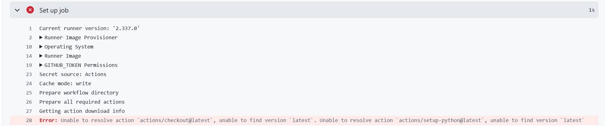
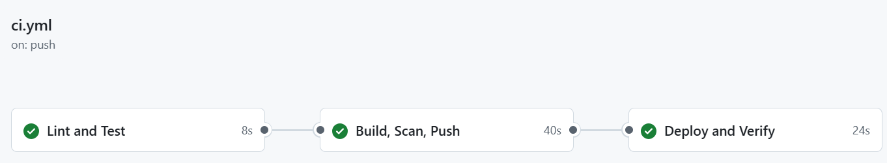
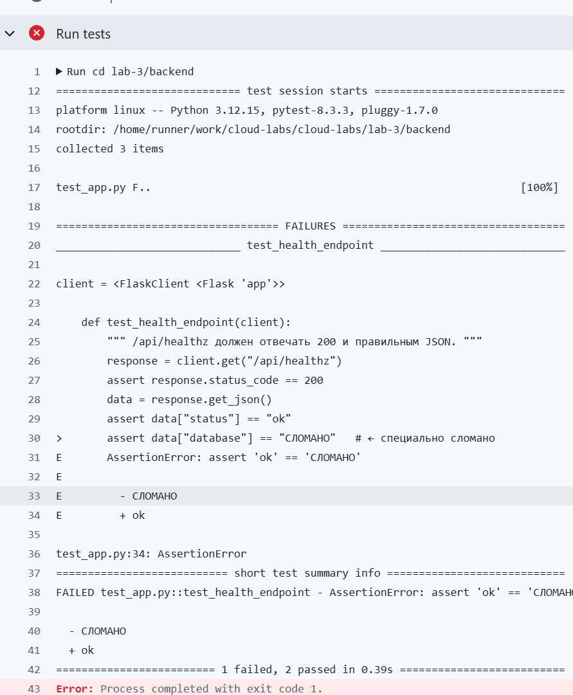
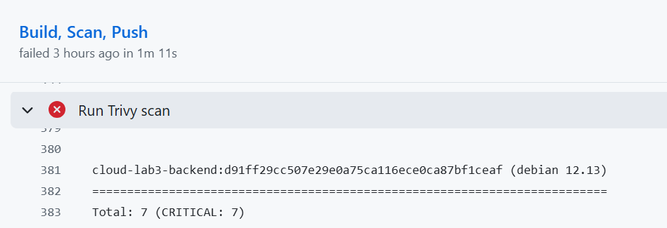
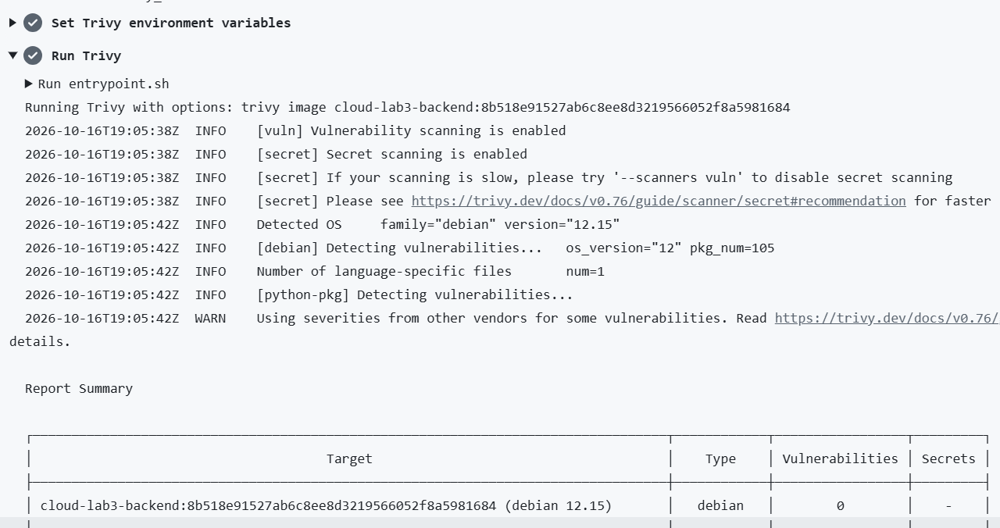
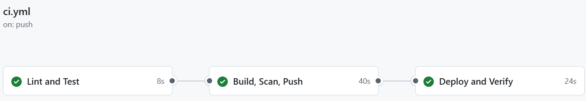
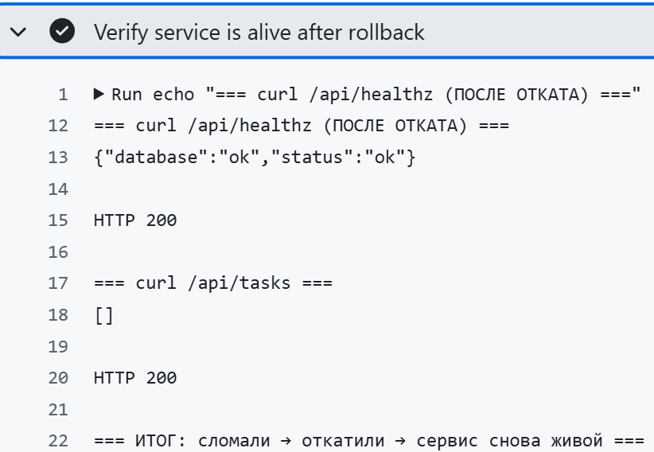
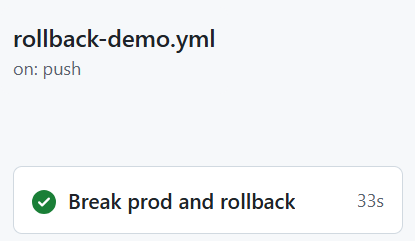
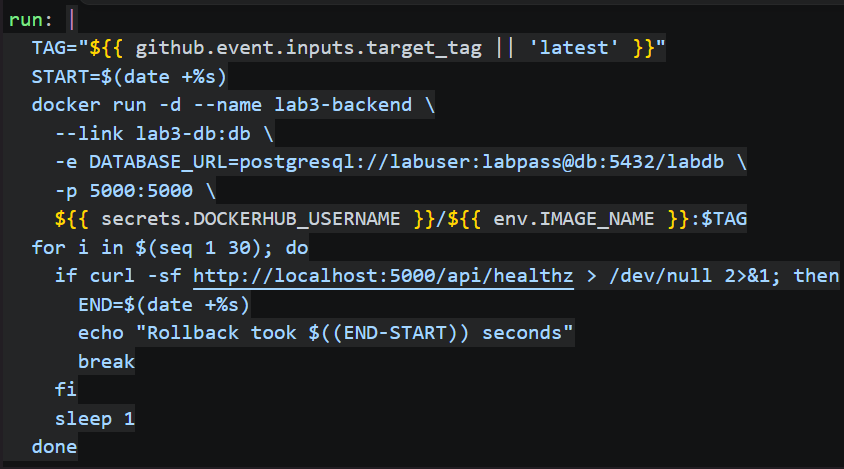
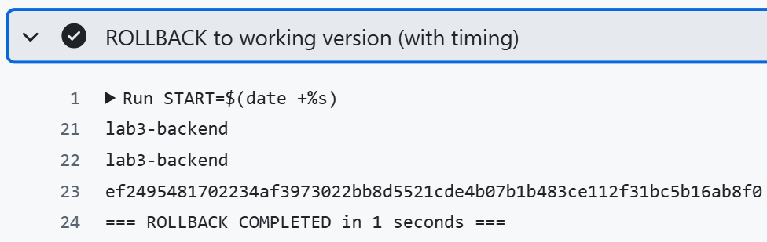

# Лабораторная 3. CI/CD + звездочка.
Цель: создать «плохой» и «хороший» CI/CD-пайплайн, проверить, на каких ошибках пайплайн останавливается, и проверить, что хороший код автоматически доходит до прода.
## Шаг 1.
В файле ci-bad.yml я создала плохой, но рабочий пайплайн. Выявилось 3 ошибки:
1. Все секреты были в общем доступе, так как это опасно, я убрала все пароли и тд в Github Seсret.
2. Четкая версия. Gihub не понимал просто обобщенный latest, нужно было прописать четко версию(@v4, @v5).
3. Не было кеша и Trivy. библиотеки скачивались заново при каждом запуске пайплайна, а про Trivy: образ не сканировался и поэтому он мог пройти в прод с дырками.
1 из ошибок 

В файле ci.yml я избавилась от этих ошибок и пайплан проходил без ошибок.

 
## Шаг 2. 

Чтобы проверить, что пайплайн точно оставновит плохой код, я специльно сломала тест. Для этого я изменила эту строку 
assert data["database"] == "ok"
на эту
assert data["database"] == "СЛОМАНО"
 После мы получили красную точку.

Когда возвращаем всё на свои места точка стаyовится зеленой.

## Шаг 3.
Чтобы устранить эти уязвимости я добавила  в Dockerfile часть run testing

RUN apt-get update \ # обновляет список, для получения новых версий
    && apt-get upgrade -y \ # обновляет сами пакеты
    && rm -rf /var/lib/apt/lists/* # удаляет кеш apt

За счёт этого все уязвимости были устранены.

до/после по severity

до 7 уязвимостей

после  0 уязвимостей

## шаг 4 

Итоговый пуш: 

Lint and Test — проверка кода и тесты

Build, Scan, Push — образ собран, просканирован (0 уязвимостей), запушен в Docker Hub

Deploy and Verify — образ скачан, запущены PostgreSQL и backend

Финальная стадия Verify live service выполнила curl на задеплоенный сервис:

Первый запрос вернул status: ok и database: ok, значит сервис работает и база данных подключена. Второй запрос вернул пустой список задач, так как база данных пустая. Оба запроса ответили HTTP 200.

Это значит, что сервис реально работает и паплайн дошел до конца.

# Звёздочка
 Цель: настроить откат на предыдущую рабочую версию, чтобы сломанный релиз можно было вернуть в строй одной командой, а не чинить прод руками.

Я создала файл rollback-demo.yml, в нём поднимается рабочий сервис, ломается, откатывается и проверяется.

Также в этом файле мы замеряем время с помощью этой части.

Мы сначала сломали, потом откатили и как итог сервис живой.

На скриншоте видим наше время.

Следовательно 1 секунда. За это время сервис возвращается в рабочее состояние.